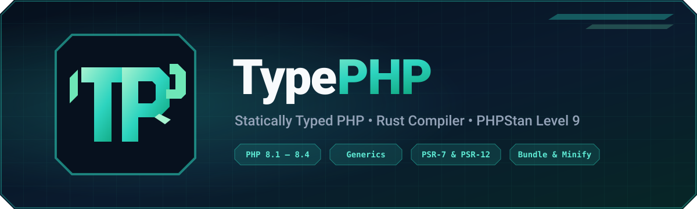
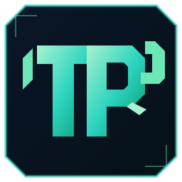

<p align="center">
  
</p>

<p align="center">
  
</p>

<h1 align="center">TypePHP (<code>tphpc</code>)</h1>

<p align="center">
  🇺🇸 English · <a href="README.vi.md">🇻🇳 Tiếng Việt</a>
</p>

**TypePHP** is a statically typed superset of PHP (inspired by TypeScript) that preserves familiar **PHP syntax** and compiles to clean, **PSR-12**-compliant **PHP 8.1–8.4** (`declare(strict_types=1);`) verified by **PHPStan Level 9**.

The `tphpc` compiler (including its built-in `--lsp` Language Server) is written in **pure Rust (`std` only, zero external crates)**.

---

## Key Features

- **Familiar PHP Syntax + Static Typing**: typed variables (`$x: int = 10;`), type inference, `const`, `function`, `class`, `interface`, backed `enum`, arrow functions `fn (...) => ...`, `global $var;`, and full PHP superglobals (`$_SERVER`, `$_GET`, `$_POST`, `$_COOKIE`, `$_SESSION`, `$_FILES`, `$_REQUEST`, `$_ENV`, `$GLOBALS`).
- **Generics & Type Aliases**: generic functions, classes, and type aliases (`identity<T>`, `Box<T>`, `Pair<A, B>`) with type argument inference.
- **Structural Shapes**: `type UserShape = { id: int, name: string, email?: string };` checked at compile time and emitted as plain PHP `array` with zero runtime overhead.
- **Unions, Nullables & Control-Flow Narrowing**: `int|string|null`, `?string`, automatic narrowing inside `if`/`else` and after early returns (`$x === null`, `is_int($x)`, `!is_string($x)`, `$x instanceof Foo`).
- **Multi-file Modules & Bundle Tree-Shaking (`--bundle`)**: `import { ... } from './...'`, `namespace`, `use` with DFS dependency loading; in `--bundle` mode, BFS reachability from the entrypoint (`main()` or top-level statements) strips unused classes, interfaces, enums, functions, `use` imports, and empty namespaces.
- **Optional Go/C-style `function main()` Entrypoint**: supports `main(): void`, `main(): int`, `main(string[] $args)`, and `main(int $argc, string[] $argv)` — automatically emitting `main();` or `exit(main());`.
- **Mandatory PHPStan Level 9 Gate**: generates `@var`, `@param`, `@return`, `@template` PHPDoc and enforces `phpstan analyse --level=9` on every build.
- **Built-in LSP Server & VS Code Extension**: `tphpc --lsp` provides Hover (signatures & constant values), `Ctrl+Click` Go-to-Definition / References, automatic PHP Reflection catalog (1,700+ native functions & 280+ classes/interfaces), and Live Diagnostics via [editors/vscode-typephp/](editors/vscode-typephp/).
- **Packaging & Optimization**: `--target <8.1|8.2|8.3|8.4>`, `--mode <preserve|bundle>`, `-o/--out <path>`, `--check`, and `--minify` (token minification, variable/function mangling, inline HTML/CSS/JS minification).

---

## Quick Example

**`hello.tphp`**:
```php
<?php

type UserShape = {
    id: int,
    name: string,
    email?: string,
};

function formatId(int|string|null $id): string {
    if ($id === null) {
        return 'none';
    }
    if (is_int($id)) {
        return 'ID#' . (string) $id;
    }
    return $id;
}

function main(): void {
    $user: UserShape = ['id' => 1, 'name' => 'Long'];
    echo formatId($user['id']) . ' - ' . $user['name'];
}
```

---

## Installation & CLI Usage

### One-line installer (like `rustup`)

Automatically installs **PHP**, **Composer**, **PHPStan Level 9**, **tphpc** (and **Rust** if building from source) and configures `PATH`:

**Linux & macOS** (`x86_64` / `arm64`):
```bash
curl -fsSL https://raw.githubusercontent.com/chaungoclong/typephp/main/install/install.sh | bash
```

**Windows (PowerShell)**:
```powershell
irm https://raw.githubusercontent.com/chaungoclong/typephp/main/install/install.ps1 | iex
```

Or install from source via Cargo:
```bash
cargo install --path .
```

### Docker Dev Environment

```bash
# Run full test suite in Docker
docker compose run --rm dev cargo test

# Open dev shell with Rust + PHP 8.4 + Composer + PHPStan Level 9
docker compose run --rm dev bash
```

Or open directly in **VS Code Dev Containers** (`.devcontainer/devcontainer.json`).

### Compile & Test

```bash
# Run full test suite
cargo test

# Type-check only without emitting PHP
cargo run -- examples/blog_app/public/index.tphp --check

# Compile preserving directory structure + PHPStan Level 9
cargo run -- examples/blog_app/public/index.tphp

# Bundle + tree-shake + minify into a single PHP file
cargo run -- examples/blog_app/public/index.tphp --bundle --minify -o dist/blog.min.php
```

---

## Repository Layout

```text
typephp/
├── src/                        # Pure-Rust compiler & LSP server (std only)
│   └── lexer.rs, ast.rs, parser.rs, types.rs, checker.rs, codegen.rs, minify.rs, lsp.rs, lib.rs, main.rs
├── tests/                      # 8 test suites (lexer, parser, ast, types_checker, codegen, minify, lsp, e2e)
├── docs/                       # Vietnamese docs + docs/en/ English docs
├── editors/vscode-typephp/     # Pure-Node VS Code extension (LSP client + TextMate grammar)
├── install/                    # Cross-OS installers (install.sh, install.ps1)
└── examples/
    ├── demo.tphp               # Core language syntax demo
    ├── tree_shake_demo/        # 4-level transitive tree-shaking demo (main -> lib1 -> lib2 -> lib3)
    ├── rest_api/               # SQLite REST API example
    ├── docker_rest_api/        # Minimal Dockerized REST API example
    ├── psr7_microfw/           # Composer PSR-4 micro-framework (PSR-7 + Router + Validator)
    └── blog_app/               # Blog + Admin app (Tailwind CSS, SQLite, Cookie Auth)
```

---

## Documentation

- [English Documentation (`docs/en/README.md`)](docs/en/README.md)
- [Vietnamese Documentation (`docs/README.md`)](docs/README.md)
- [Language Specification (`SPEC.md`)](SPEC.md)
- [Developer Guide & PR Rules (`AGENTS.md`)](AGENTS.md)
