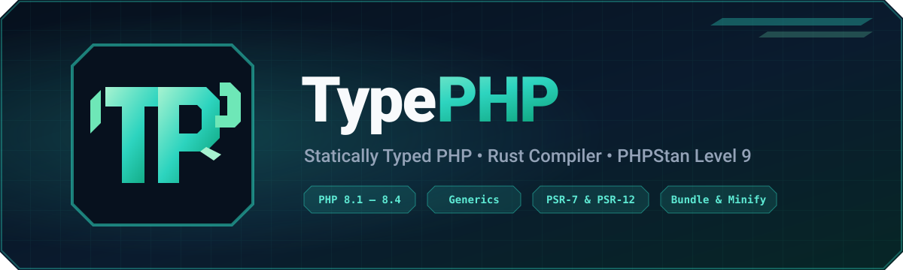
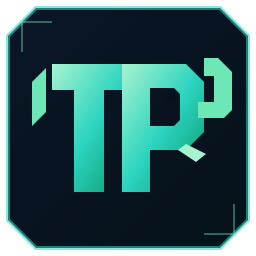

<p align="center">
  
</p>

<p align="center">
  
</p>

<h1 align="center">TypePHP (<code>tphpc</code>)</h1>

<p align="center">
  <a href="README.md">🇺🇸 English</a> · 🇻🇳 Tiếng Việt
</p>

**TypePHP** là ngôn ngữ lập trình kiểu tĩnh mạnh (lấy cảm hứng từ TypeScript) giữ nguyên phong cách cú pháp **PHP** và biên dịch sang mã **PHP 8.1–8.4** (`declare(strict_types=1);`) an toàn, tối ưu hiệu suất, chuẩn **PSR-12** và vượt qua **PHPStan Level 9**.

Trình biên dịch `tphpc` (kèm Language Server `--lsp`) được viết hoàn toàn bằng **Rust thuần (`std` only, không phụ thuộc crate ngoài)**.

---

## Tính năng chính

- **Cú pháp PHP quen thuộc + Định kiểu mạnh**: khai báo kiểu cho biến (`$x: int = 10;`), suy luận kiểu tự động, `const`, `function`, `class`, `interface`, backed `enum`, arrow function `fn (...) => ...`, `global $var;`, và đầy đủ PHP superglobals (`$_SERVER`, `$_GET`, `$_POST`, `$_COOKIE`, `$_SESSION`, `$_FILES`, `$_REQUEST`, `$_ENV`, `$GLOBALS`).
- **Generics & Type Aliases**: hỗ trợ generic trên hàm, class, type alias (`identity<T>`, `Box<T>`, `Pair<A, B>`) kèm suy luận tham số kiểu.
- **Structural Shapes**: `type UserShape = { id: int, name: string, email?: string };` kiểm tra key/kiểu lúc compile và biên dịch thành `array` PHP với zero runtime overhead.
- **Union, Nullable & Control-Flow Narrowing**: `int|string|null`, `?string`, tự động thu hẹp kiểu trong nhánh `if`, `else` và sau `return` sớm (`$x === null`, `is_int($x)`, `!is_string($x)`, `$x instanceof Foo`).
- **Module đa file & Tree-Shaking (`--bundle`)**: `import { ... } from './...'`, `namespace`, `use` với đồ thị phụ thuộc; ở chế độ `--bundle`, compiler duyệt BFS từ entrypoint (`main()` hoặc top-level statements) để loại bỏ toàn bộ class, interface, enum, function, `use` và namespace không dùng tới.
- **Entrypoint `function main()` tuỳ chọn (kiểu Go / C)**: hỗ trợ `main(): void`, `main(): int`, `main(string[] $args)`, `main(int $argc, string[] $argv)` — tự động gọi `main();` hoặc `exit(main());` ở cuối entrypoint.
- **PHPStan Level 9 Gate**: tự động sinh PHPDoc (`@var`, `@param`, `@return`, `@template`) và chạy `phpstan analyse --level=9` ngay trong bước biên dịch.
- **LSP Server & VS Code Extension**: tích hợp `tphpc --lsp` (Hover chữ ký & giá trị hằng số, `Ctrl+Click` Go-to-Definition / References, PHP Reflection catalog tự động quét 1.700+ hàm & 280+ class PHP gốc, Live Diagnostics) cùng extension thuần Node tại [editors/vscode-typephp/](editors/vscode-typephp/).
- **Tuỳ chọn đóng gói & tối ưu**: `--target <8.1|8.2|8.3|8.4>`, `--mode <preserve|bundle>`, `-o/--out <path>`, `--check`, và `--minify` (nén PHP, rút gọn tên biến/hàm, nén HTML/CSS/JS nhúng trong chuỗi).

---

## Ví dụ nhanh

**`hello.tphp`**:
```php
<?php

type UserShape = {
    id: int,
    name: string,
    email?: string,
};

function formatId(int|string|null $id): string {
    if ($id === null) {
        return 'none';
    }
    if (is_int($id)) {
        return 'ID#' . (string) $id;
    }
    return $id;
}

function main(): void {
    $user: UserShape = ['id' => 1, 'name' => 'Long'];
    echo formatId($user['id']) . ' - ' . $user['name'];
}
```

---

## Cài đặt & Sử dụng CLI

### Cài đặt tự động 1 lệnh (giống `rustup`)

Script tự động cài đặt đầy đủ môi trường (**PHP**, **Composer**, **PHPStan Level 9**, **tphpc**, và tự cài **Rust** nếu cần build từ source) và cấu hình `PATH`:

**Linux & macOS** (`x86_64` / `arm64`):
```bash
curl -fsSL https://raw.githubusercontent.com/chaungoclong/typephp/main/install/install.sh | bash
```

**Windows (PowerShell)**:
```powershell
irm https://raw.githubusercontent.com/chaungoclong/typephp/main/install/install.ps1 | iex
```

Hoặc cài đặt trực tiếp từ source bằng Cargo:
```bash
cargo install --path .
```

### Môi trường phát triển bằng Docker

```bash
# Chạy toàn bộ test suite trong Docker
docker compose run --rm dev cargo test

# Mở shell dev đầy đủ Rust + PHP 8.4 + Composer + PHPStan Level 9
docker compose run --rm dev bash
```

Hoặc mở trực tiếp bằng **VS Code Dev Containers** (`.devcontainer/devcontainer.json`).

### Biên dịch & Kiểm thử

```bash
# Chạy toàn bộ test suite
cargo test

# Kiểm tra kiểu tĩnh (không sinh file .php)
cargo run -- examples/blog_app/public/index.tphp --check

# Biên dịch giữ nguyên cấu trúc thư mục + chạy PHPStan Level 9
cargo run -- examples/blog_app/public/index.tphp

# Biên dịch gộp 1 file + tree-shaking + minify (PHP, biến/hàm, HTML/CSS/JS)
cargo run -- examples/blog_app/public/index.tphp --bundle --minify -o dist/blog.min.php
```

---

## Cấu trúc thư mục

```text
typephp/
├── src/                        # Source compiler & LSP server viết bằng Rust (std only)
│   └── lexer.rs, ast.rs, parser.rs, types.rs, checker.rs, codegen.rs, minify.rs, lsp.rs, lib.rs, main.rs
├── tests/                      # 8 bộ test theo module (lexer, parser, ast, types_checker, codegen, minify, lsp, e2e)
├── docs/                       # Tài liệu tiếng Việt + bản tiếng Anh trong docs/en/
├── editors/vscode-typephp/     # VS Code extension thuần Node (LSP client + TextMate grammar)
├── install/                    # Script cài đặt đa nền tảng (install.sh, install.ps1)
└── examples/
    ├── demo.tphp               # Demo tổng hợp cú pháp TypePHP
    ├── tree_shake_demo/        # Demo tree-shaking bắc cầu 4 tầng (main -> lib1 -> lib2 -> lib3)
    ├── rest_api/               # REST API chuẩn REST kết nối SQLite
    ├── docker_rest_api/        # REST API tối giản trong Docker
    ├── psr7_microfw/           # Composer package PSR-4 micro-framework (PSR-7 + Router + Validator)
    └── blog_app/               # Ứng dụng Blog + Admin (Tailwind CSS, SQLite, Cookie Login)
```

---

## Tài liệu tham khảo

- [Tài liệu chi tiết Tiếng Việt (`docs/README.md`)](docs/README.md)
- [English Documentation (`docs/en/README.md`)](docs/en/README.md)
- [Đặc tả ngôn ngữ (`SPEC.md`)](SPEC.md)
- [Hướng dẫn phát triển & PR (`AGENTS.md`)](AGENTS.md)
